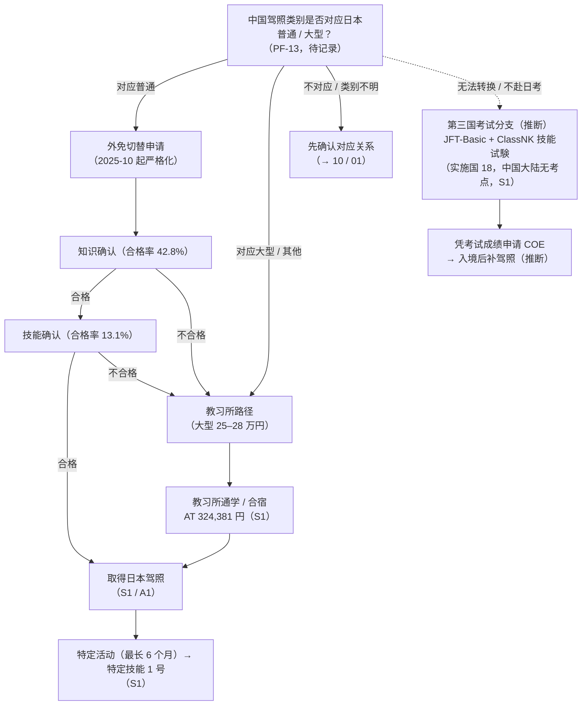
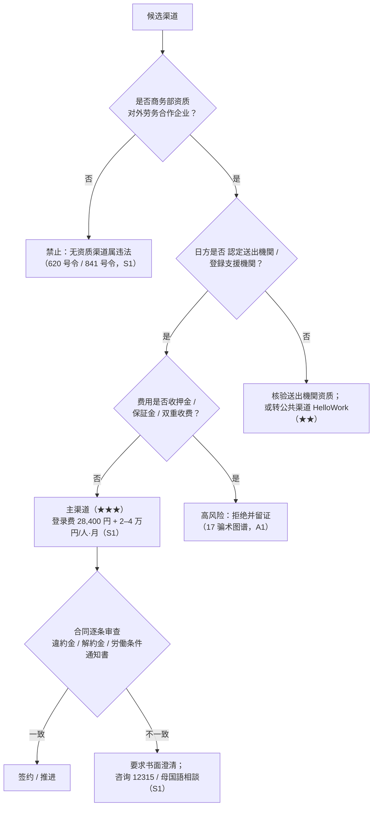

# 赴日决策 · 决策树（条件化分支）

> **用途**：00 模块的**条件化决策树**，把两个高频决策场景（驾照转换 / 中介渠道选择）拆成可判读的分支。
> **纪律**：每个分支标注来源与置信度（见 [置信度分级标准](../prompts/confidence-grade-standard.md)）；推断分支标「推断」，不构成法律意见。
> **接入**：[decision_onepager.md](./decision_onepager.md) 与 [decision_hub_registry.md](./decision_hub_registry.md) 统一入口引用本文件。

---

## 一、驾照转换决策树

**分支判读**：

| 分支 | 条件 | 结论 | 置信度 |
|---|---|---|---|
| 外免切替成功 | 中国驾照对应 + 知识 / 技能确认均合格 | 取得日本驾照，转 1 号 | A1（成功率低） |
| 外免切替失败 → 教习所 | 确认不合格 | 预留 30–40 万円 + 6–12 个月 | S1（费用）/ C3（耗时推断） |
| 第三国考试 | 中国大陆无考点 | 赴有考点国家 / 地区考 JFT-Basic + 技能试験 | S1（考点）/ C3（路径推断） |

---

## 二、中介渠道选择决策树

**分支判读**：

| 分支 | 条件 | 结论 | 置信度 |
|---|---|---|---|
| 主渠道 | 商务部资质 + 日方認定 / 登録 + 无押金 | 可推进，仍须合同审查 | S1 |
| 公共渠道 | 无合格中介 | HelloWork / 企業直招 | B1 |
| 高风险 | 收押金 / 保証金 / 双重收费 | 拒绝，留证举报 | A1 |
| 合同不一致 | 口头承诺 ≠ 书面 | 要求书面澄清 | S1 |

---

## 三、版本记录

| 版本 | 日期 | 变更 | 说明 |
|---|---|---|---|
| v1.0 | 2026-11-15 | 初始版本 | 建立驾照转换 / 中介渠道两棵条件化决策树，接入 00 统一入口 |
