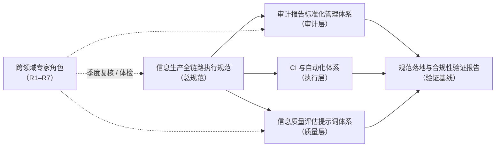

# 文档索引（docs/）

> **版本**：v1.0（2026-11-16）
> **用途**：本目录是 jp-life-work 的**规范与审计标准单一入口**。后续开发、审计、协作以本目录文档为准。
> **维护纪律**：规范类文档修订须同步更新 `src/tests/test_tools.py` 中对应守卫测试（如 `TestPipelineFlowSpec`、`test_ci_doc_documents_reuse`），并经合并门禁校验。

---

## 一、文档清单与定位

| 文档 | 定位 | 何时查阅 |
|---|---|---|
| [信息生产全链路执行规范](信息生产全链路执行规范.md)（PIPELINE-FLOW-SPEC） | **总规范**：五层架构、五阶段交付物、五闸 + 交付门禁、P0/P1 五类缺陷路由、周期保障、决策消费与补缺准入、落地纪律、阈值速查 | 写报告 / 走流程 / 判断门禁是否通过时 |
| [审计报告标准化管理体系](审计报告标准化管理体系.md)（AuditGuard） | **审计标准**：L1–L5 校验、审计状态机、哈希链台账、已审计标识、验收与月度抽检 | 提交审计 / 处理审计状态 / 门禁 `--gate` 时 |
| [信息质量评估提示词体系](信息质量评估提示词体系.md)（InfoQuality-Guard） | **质量标准**：四维度指标、C-01～C-14 混乱分类、S-01～S-11 修复规范、程序化与语义边界 | 评估内容质量 / 修复混乱 / 判定 C/S 码时 |
| [CI 与自动化体系](CI.md) | **CI 与自动化**：7 条工作流、报告生命周期、命名分类、跨月对比、226 项测试、手动命令、复用一致性、并行协作 | 排查 CI / 手动跑校验 / 新增工作流时 |
| [跨领域专家角色清单与专属提示词模板](cross-domain-expert-roles.md) | **分析角色**：R1–R7 跨领域专家（技术实现 / 业务逻辑 / 用户体验 / 风险管控 / 数据治理 / 合规审计 / 交叉验证）及提示词模板 | 季度复核 / 新主题准入 / 全面体检时 |
| [规范落地与合规性验证报告](规范落地与合规性验证报告.md) | **验证基线**：规范落地结论、资产核验、关键退出码、待整改项、执行约束，含 2026-11-16 全面重生成核验 | 回溯规范落地状态 / 处理历史待整改项时 |
| [CI 流水线对齐校验报告](CI流水线对齐校验报告-2026-11-16.md) | **CI 对齐校验**（一次性）：流水线三维比对、12 项差异定位、10 项闭环整改与实施清单 | 排查 CI 与规范一致性 / 回溯本次对齐时 |

---

## 二、文档关系

- **总规范**是流程与执行的事实源；**审计标准**与**质量标准**是其两套专篇（审计化落地 / 内容质量）；**CI 文档**是执行载体；**角色手册**是周期性复核的分析工具；**验证报告**是历史基线。
- 术语与退出码统一：`0=通过 / 1=阻断（P0/P1）/ 2=放行（P2）`；阈值速查见总规范附录 B。

---

## 三、维护规则

1. **单一事实源**：同类规则只在一处定义，其他文档引用（如阈值、退出码、状态机）。
2. **同步守卫**：修改总规范 / CI 文档的节标题、闸名、命令名时，须同步 `src/tests/test_tools.py`（`TestPipelineFlowSpec`、`test_ci_doc_documents_reuse`、`TestThreeSystemAlignment`）与引用它们的工具注释。
3. **版本记录**：每份文档变更须追加版本记录（日期 + 变更 + 说明）。
4. **口径一致**：工具数、工作流数、测试数等易变数字以代码库实测为准，变更后同步更新全部文档。
