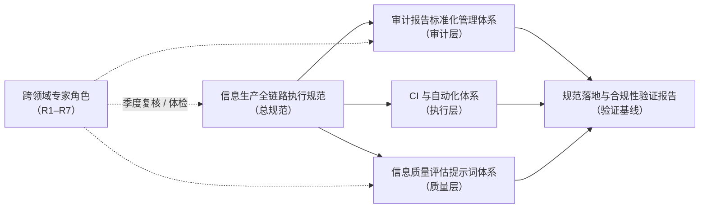

# 文档索引（docs/）

> **版本**：v1.4（2026-11-18）
> **用途**：本目录是 jp-life-work 的**规范与审计标准单一入口**。后续开发、审计、协作以本目录文档为准。
> **维护纪律**：规范类文档修订须同步更新 `engine/tests/test_tools.py` 中对应守卫测试（如 `TestPipelineFlowSpec`、`test_ci_doc_documents_reuse`），并经合并门禁校验。

---

## 一、文档清单与定位

| 文档 | 定位 | 何时查阅 |
|---|---|---|
| [信息生产全链路执行规范](信息生产全链路执行规范.md)（PIPELINE-FLOW-SPEC） | **总规范**：五层架构、五阶段交付物、五闸 + 交付门禁、P0/P1 五类缺陷路由、周期保障、决策消费与补缺准入、落地纪律、阈值速查 | 写报告 / 走流程 / 判断门禁是否通过时 |
| [审计报告标准化管理体系](审计报告标准化管理体系.md)（AuditGuard） | **审计标准**：L1–L5 校验、审计状态机、哈希链台账、已审计标识、验收与月度抽检 | 提交审计 / 处理审计状态 / 门禁 `--gate` 时 |
| [信息质量评估提示词体系](信息质量评估提示词体系.md)（InfoQuality-Guard） | **质量标准**：四维度指标、C-01～C-14 混乱分类、S-01～S-11 修复规范、程序化与语义边界 | 评估内容质量 / 修复混乱 / 判定 C/S 码时 |
| [主题提示词库体系](提示词库体系.md)（Prompt Library） | **信息传播**：三层主题分类（域/主题/场景）、5 个可复用原型（术语对齐 / 缺口诊断 / 证据核验 / 场景传播 / 覆盖核验）、21 主题画像总表、三维核验框架 | 按主题产出/核验/传播信息 / 消除信息差 / 新增主题准入时 |
| [CI 与自动化体系](CI.md) | **CI 与自动化**：8 条工作流、报告生命周期、命名分类、跨月对比、工作区卫生横切清理、工具链开发规约、868 项测试、手动命令、复用一致性、并行协作 | 排查 CI / 手动跑校验 / 新增工作流时 |
| [工具链开发规约](toolchain/TOOLCHAIN-DEV-SPEC.md)（TOOLCHAIN-DEV-SPEC） | **代码交付域**：适用范围（仅代码）、六阶段（规格先行 / 工单化 / TDD / 实现 / 双轴评审 / 合并前检查单）、豁免阈值、覆盖率单一事实源门禁 | 改工具链代码 / 新增工具 / 合并前检查时 |
| [mainline 融合评估报告-2026-11-17](mainline融合评估报告-2026-11-17.md)（评估） | **规范融合评估**：11 阶段逐项评估、边界判定、风险 R1–R8、P0–P3 落地路线与验收 | 回溯本规约 / 覆盖率门禁 / 双轴评审依据时 |
| [跨领域专家角色清单与专属提示词模板](cross-domain-expert-roles.md) | **分析角色**：R1–R7 跨领域专家（技术实现 / 业务逻辑 / 用户体验 / 风险管控 / 数据治理 / 合规审计 / 交叉验证）及提示词模板 | 季度复核 / 新主题准入 / 全面体检时 |
| [规范落地与合规性验证报告](规范落地与合规性验证报告.md) | **验证基线**：规范落地结论、资产核验、关键退出码、待整改项、执行约束，含 2026-11-16 全面重生成核验 | 回溯规范落地状态 / 处理历史待整改项时 |
| [CI 流水线对齐校验报告](CI流水线对齐校验报告-2026-11-16.md) | **CI 对齐校验**（第一轮，一次性）：流水线三维比对、12 项差异定位、11 项闭环整改与实施清单 | 排查 CI 与规范一致性 / 回溯本次对齐时 |
| [CI 流水线对齐校验报告（第二轮）](CI流水线对齐校验报告-2026-11-16-r2.md) | **CI 对齐校验**（第二轮）：工作区卫生横切后复校，8 项差异定位（P1×1 / P2×7）与全部整改 | 复核本轮整改 / 回溯横切后的对齐状态时 |
| [月度报告批量更新唤醒词与执行手册](月度批量更新唤醒词.md)（MONTHLY-BATCH-UPDATE） | **批量执行入口**：唤醒词清单、可选参数、七步执行流程、平台挂载与迁移性原则 | 一键更新本月全部报告 / 迁移平台后挂载唤醒词时 |
| [端到端流水线编排系统设计-2026-11-17](端到端流水线编排系统设计-2026-11-17.md)（设计） | **编排设计**：方案对比与择优、系统边界、六阶段状态机、触发检测 / 编排 / 监控 / CI 接线、交付物 D1–D10 | 理解编排层设计 / 评审方案时 |
| [流水线编排实施计划-2026-11-17](流水线编排实施计划-2026-11-17.md)（计划） | **实施计划**：T1–T7 任务节点、接口契约、测试先行步骤、验收标准 | 按任务推进编排实施时 |
| [端到端流水线治理标准](端到端流水线治理标准.md)（PIPELINE-ORCHESTRATOR-GOV） | **治理标准**：阶段定义 / 命名 / 状态机 / 异常 / 漂移检测 / 变更 / 版本 | 变更编排阶段 / 阈值 / 边界时 |
| [流水线优化一致性对齐验证报告-2026-11-17](流水线优化一致性对齐验证报告-2026-11-17.md)（一致性报告） | **对齐验证**：设计 ↔ 计划 ↔ 实现逐条对照、D1–D10 交付物、验收指标与实测结果 | 复核编排交付完整性 / 回溯实施基线时 |
| [分支管理规范与操作手册](branch-management.md)（BRANCH-NAMING） | **分支规范**：`task/<slug>-<sid>` 命名、`branch_naming.py` 校验、pre-push / pre-commit 钩子、存量补全与台账 | 建任务分支 / 排查分支命名 / 合并异常时 |
| [引擎层迁移方案-2026-11-17](引擎层迁移方案-2026-11-17.md)（迁移方案） | **迁移事实源**：旧引擎层 → `engine/`、根协作脚本 → `engine/scripts/` 的目标结构、路径映射、深度推导、校验与回滚 | 回溯引擎层迁移 / 处理旧路径引用时 |
| [代码冗余与无效代码清理报告-2026-11-17](代码冗余与无效代码清理报告-2026-11-17.md)（清理留痕） | **清理留痕**：未使用导入 / 冗余代码清单与处置 | 回溯工具链清理时 |
| [架构优化技术方案-2026-11-16](架构优化技术方案-2026-11-16.md)（方案） | **架构方案**：A–G 方向、边界、风险预案与统一验收标准 | 回溯架构优化依据时 |
| [架构优化实施清单-2026-11-16](架构优化实施清单-2026-11-16.md)（清单） | **实施清单**：23 项原子任务、依赖、交付标准与时间节点 | 回溯架构优化任务拆分时 |
| [架构优化基线报告-2026-11-16](架构优化基线报告-2026-11-16.md)（基线） | **基线度量**：构建 / 校验耗时、体积、易变数字清单 | 性能与规模对比基线 |
| [架构优化实施结果验证报告-2026-11-16](架构优化实施结果验证报告-2026-11-16.md)（验证） | **实施验证**：交付物、逐项结果、验证证据与遗留说明 | 回溯架构优化验收时 |
| [输入润色与确认门禁](输入润色与确认门禁.md)（Prompt Polish & Confirm Gate） | **交互规范**：任务型输入先润色、再确认、后执行；句末问号直接回答；五段模板、确认认定、跨 IDE / 模型 | 收到任务型输入 / 判断是否需要先确认时 |
| [输入门禁可移植性方案](输入门禁可移植性方案.md) | **可移植性**：跨 IDE / 跨模型 / 跨机器的载体、判定、迁移与验证；`bootstrap_gate` / `check_gate` 脚本 | 换新机器 / 换 IDE / 自检门禁时 |
| [信息差消除与决策对齐优化解决方案-2026-11-18](信息差消除与决策对齐优化解决方案-2026-11-18.md)（方案/清单） | **优化方案**：三大目标操作化、全仓缺口诊断（引擎/CI + 内容层）、解决方案、P0/P1/P2 实施清单与验证方案 | 规划优化落地 / 查缺口与实施顺序时 |
| [全量重审与综合诊断报告-2026-11-18](全量重审与综合诊断报告-2026-11-18.md)（重审/诊断） | **全量重审**：六维度并行审计（架构/来源事实/词库/提示词/报告/门禁度量）+ 三维目标逐项评估与差距归因 + 更新实施清单 | 查最新证据 / 排实施优先级时 |
| [实施结果验证报告-2026-11-18](实施结果验证报告-2026-11-18.md)（验证） | **实施验证**：4 批次提交、目标→指标对齐矩阵（前/后）、工程证据、未完成项 | 查落地进度 / 验收时 |

### 工具链开发域（`docs/toolchain/`）

| 文档 | 定位 |
|---|---|
| [工具链开发规约](toolchain/TOOLCHAIN-DEV-SPEC.md)（TOOLCHAIN-DEV-SPEC） | 代码交付域六阶段 / 豁免阈值 / 覆盖率门禁 / 双轴评审 / 合并前检查单 |
| [规格：coverage-gate](toolchain/specs/coverage-gate.md) | 覆盖率门禁 + 评审软门禁规格（S1） |
| [工单：coverage-gate](toolchain/tickets/coverage-gate.md) | coverage-gate 任务工单（S2） |
| [双轴评审：coverage-gate](toolchain/reviews/coverage-gate-review.md) | coverage-gate 双轴评审（S5） |
| [双轴评审：引擎层迁移](toolchain/reviews/engine-migration-review.md) | SRC→ENGINE 迁移双轴评审（S5） |
| [双轴评审：迁移后治理](toolchain/reviews/post-migration-governance-review.md) | 迁移后全仓治理与清障双轴评审（S5） |

---

## 二、文档关系

- **总规范**是流程与执行的事实源；**审计标准**与**质量标准**是其两套专篇（审计化落地 / 内容质量）；**CI 文档**是执行载体；**角色手册**是周期性复核的分析工具；**验证报告**是历史基线。
- 术语与退出码统一：`0=通过 / 1=阻断（P0/P1）/ 2=放行（P2）`；阈值速查见总规范附录 B。

---

## 三、维护规则

1. **单一事实源**：同类规则只在一处定义，其他文档引用（如阈值、退出码、状态机）。
2. **同步守卫**：修改总规范 / CI 文档的节标题、闸名、命令名时，须同步 `engine/tests/test_tools.py`（`TestPipelineFlowSpec`、`test_ci_doc_documents_reuse`、`TestThreeSystemAlignment`）与引用它们的工具注释。
3. **版本记录**：每份文档变更须追加版本记录（日期 + 变更 + 说明）。
4. **口径一致**：工具数、工作流数、测试数等易变数字以代码库实测为准，变更后同步更新全部文档。

---

## 四、版本记录

| 版本 | 日期 | 变更 | 说明 |
|---|---|---|---|
| v1.0 | 2026-11-16 | 初始版本 | 建立文档索引单一入口：文档清单与定位、文档关系、维护规则 |
| v1.1 | 2026-11-17 | 迁移后治理 | 补索引 `branch-management` / `引擎层迁移方案` / `代码冗余清理报告` / `架构优化` 4 份与 `docs/toolchain/` 子目录；测试数 822 → 863；删除 2 份无入链一次性文档 |
| v1.2 | 2026-11-18 | 新增交互规范 | 索引 `输入润色与确认门禁`（任务型输入先润色确认后执行） |
| v1.3 | 2026-11-18 | 同步门禁修订 | 门禁 doc 升 v1.1（句末问号豁免 + 跨 IDE / 模型）；索引描述同步 |
| v1.4 | 2026-11-18 | 新增可移植性方案 | 索引 `输入门禁可移植性方案`（跨 IDE / 跨模型 / 跨机器 + bootstrap / check 脚本） |
| v1.5 | 2026-11-18 | 新增优化解决方案 | 索引 `信息差消除与决策对齐优化解决方案-2026-11-18`（三大目标操作化 + 缺口诊断 + P0/P1/P2 清单 + 验证方案） |
| v1.6 | 2026-11-18 | 新增全量重审报告 | 索引 `全量重审与综合诊断报告-2026-11-18`（六维度并行审计 + 三维目标诊断 + 差距归因 + 更新清单） |
| v1.7 | 2026-11-18 | 新增实施结果验证报告 | 索引 `实施结果验证报告-2026-11-18`（4 批次提交 + 指标对齐矩阵 + 工程证据 + 未完成项） |
