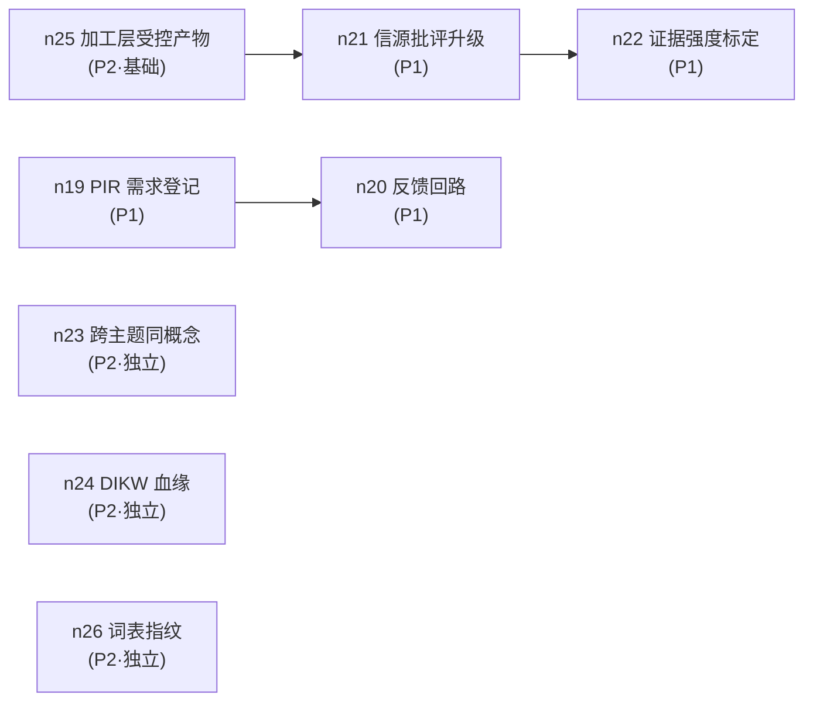

# 工具链工单总览（TICKETS-INDEX）

> **定位**：`docs/toolchain/tickets/` 下全部工单的单一索引，含依赖图、优先级批次、状态与验收摘要。
> **来源**：情报科学五框架分析（会话，2026-11-20）细化的 n19–n26 工单。
> **维护**：工单状态变更时同步本表；新工单追加行并在依赖图补节点。
> **版本**：v1.0（2026-11-20）

---

## 一、依赖图

- **链 1（基础 → 信源 → 证据）**：`n25 → n21 → n22`。n25 先把归一化与 source-index 受控化，n21 才有稳定字段做来源质量四维；n22 在 n21 的来源类型/独立性上做证据强度合成。
- **链 2（需求 → 反馈）**：`n19 → n20`。n19 定义需求编号规则，n20 的反馈事件与指标才能关联需求。
- **独立**：`n23`（词表）、`n24`（血缘）、`n26`（词表指纹）互不依赖，可并行。

## 二、优先级批次

| 批次 | 工单 | 优先级 | 依赖 | 说明 |
|---|---|---|---|---|
| 批 1 | n25 | P2（基础） | — | 加工层受控产物与归一化单一事实源 |
| 批 1 | n21 | P1 | n25 | 信源批评四维 + L5 第 7 项 |
| 批 1 | n22 | P1 | n21 | 证据类型/强度码 + 合成规则 |
| 批 2 | n19 | P1 | — | PIR 需求登记与覆盖矩阵 |
| 批 2 | n20 | P1 | n19 | 反馈回路指标与工作流 |
| 批 3 | n23 | P2 | — | 跨主题同概念对齐 |
| 批 3 | n24 | P2 | — | DIKW 端到端血缘 |
| 批 3 | n26 | P2 | — | 词表变更审计指纹 |

## 三、工单状态表

| 工单 | 标题 | 级别 | 分支 | worktree | 状态 |
|---|---|---|---|---|---|
| [n19](n19-pir-requirements.md) | 规划层情报需求登记 | P1 | `task/n19-pir-requirements-b5958a4c` | `.worktrees/n19-pir-requirements` | 已实施（未提交） |
| [n20](n20-feedback-loop.md) | 反馈层「使用 → 规划」回路 | P1 | `task/n20-feedback-loop-b5958a4c` | `.worktrees/n20-feedback-loop` | 已实施（未提交） |
| [n21](n21-source-criticism.md) | 信源批评升级（来源质量四维） | P1 | `task/n21-source-criticism-b5958a4c` | `.worktrees/n21-source-criticism` | 已实施（未提交） |
| [n22](n22-evidence-strength.md) | 证据强度标定与合成规则 | P1 | `task/n22-evidence-strength-b5958a4c` | `.worktrees/n22-evidence-strength` | 已实施（未提交） |
| [n23](n23-vocab-cross-topic.md) | 受控词表跨主题同概念对齐 | P2 | `task/n23-vocab-cross-topic-b5958a4c` | `.worktrees/n23-vocab-cross-topic` | 已实施（未提交） |
| [n24](n24-dikw-lineage.md) | DIKW 端到端血缘视图 | P2 | `task/n24-dikw-lineage-b5958a4c` | `.worktrees/n24-dikw-lineage` | 已实施（未提交） |
| [n25](n25-processing-controlled.md) | 加工层受控中间产物（source-index 入册） | P2 | `task/n25-processing-controlled-b5958a4c` | `.worktrees/n25-processing-controlled` | 已实施（未提交） |
| [n26](n26-vocab-fingerprint.md) | 词表变更审计指纹 | P2 | `task/n26-vocab-fingerprint-b5958a4c` | `.worktrees/n26-vocab-fingerprint` | 已实施（未提交） |

> **进度（2026-11-20）**：8 张工单全部**已实施（未提交）**；各自 worktree 内 `validate.py` rc=0，相关 unittest（test_tools / test_source_check / test_cov_audit / test_counterexample_scan / test_decision_metrics / test_l5_meta_check）全绿。

## 四、验收判据摘要

> 完整判据以各工单文件为准；此处仅列关键门禁。

| 工单 | 关键验收门禁 |
|---|---|
| n19 | `update_planner --requirements --porcelain` 字段齐全；`decision_metrics` 需求指标；守卫测试；unittest 全绿 |
| n20 | `decision_metrics` 反馈指标；维护工作流反馈汇总步骤；`decision_log --check` 关联需求 |
| n21 | Schema 扩列；`source_check` 六元组；L5 第 7 项 + backfill 后 `l5_meta_check` rc=0 |
| n22 | 证据强度码与合成规则入标准；`counterexample_scan` 单源扫描；`audit_check` L4 强度匹配 |
| n23 | `vocab_tool cross-check`；`info_quality_check` C-15；工作流步骤 + 守卫测试 |
| n24 | `fact_card_check` 血缘索引；`decision_metrics` 五问血缘；00 登记册血缘节 |
| n25 | `source-index.json` 入库受控；归一化集中；E5 字段完整率 |
| n26 | `audit-gate.yml` 词库哈希校验；`vocab_hash` 登记 |

## 五、实施注意事项

1. **工单可见性**：n19–n26 工单与本索引当前在共享检出目录为**未跟踪文件**，尚未提交；8 个 worktree 基于 `origin/main`，**暂不含这些工单**。实施前需先提交工单与索引（提交/合并需单独授权，走 `workflow_guard merge`）。
2. **依赖顺序**：批 1 内 n25 → n21 → n22 必须串行；n21 的 Schema 扩列与 L5 增项会波及 21 份存量报告，**先出 backfill 映射说明再补录**。
3. **公共基础**：n25 的归一化函数是 n21/n22 的公共依赖，优先排期。
4. **会话隔离**：所有实施在各自 worktree 内进行；不直接改 main；不碰其他会话任务（如 `b1-source-annotation-p1`）。
5. **提示词对齐**：实施与验收统一使用会话发布的「实施对齐提示词」与「验收提示词」模板（见会话，2026-11-20），确保与方案规划一致。

## 六、版本记录

| 版本 | 日期 | 变更 |
|---|---|---|
| v1.0 | 2026-11-20 | 初始版本：n19–n26 依赖图、优先级批次、状态表、验收摘要 |
| v1.1 | 2026-11-20 | 8 张工单全部实施完成（未提交），状态表同步为「已实施（未提交）」 |
