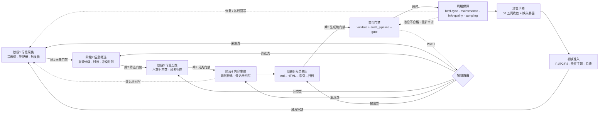

# 信息生产全链路执行规范（PIPELINE-FLOW-SPEC）

> **版本**：v1.0（2026-11-15）
> **适用范围**：jp-life-work 全部 21 个主题（`00`–`20`）
> **上位依据**：[CI.md 第十一节 · 信息生产全链路（闭环与阶段闸）](CI.md)、[审计报告标准化管理体系](审计报告标准化管理体系.md)、[信息质量评估提示词体系](信息质量评估提示词体系.md)
> **硬性纪律**：**任何跨阶段流转，必须经对应门禁校验通过后方可进入下一环节**；门禁未过即回源阶段，不允许「带病前进」。
> **工具**：`src/prompts-tools/tools/`；**测试守卫**：`src/tests/test_tools.py::TestPipelineFlowSpec`

---

## 一、总则

### 1.1 全链路图（与本文一一对应）

### 1.2 节点 · 载体 · 判定对照

| 节点 | 载体（工具 / 工作流） | 判定依据 |
|---|---|---|
| 阶段1 信息采集 | `prompts/business-config.md`、`prompts/prompt-*.md`、`data/*_indicator_registry.md` | 闸1（`stage_gate_check.py` G1-*）+ `validate.py` |
| 阶段2 信息筛选 | 报告内来源标注、登记册核验日期、口径冲突并列清单 | 闸2（G2-*）+ `info_quality_check` C-07/C-08/C-10/C-14 |
| 阶段3 信息分类 | `report-classification.md` 六族十三类、`template-registry.md`、命名规范 | 闸3（G3-*）+ `validate.py` / `classify_reports.py` / `compliance_check.py` |
| 阶段4 内容生成 | 四层继承体系、`reports/YYYY-MM-<slug>.md` | `audit_preflight.py` → `audit_check.py` L1–L5 → `audit_pipeline.py --submit` |
| 阶段5 报告输出 | `md2html.py`、`build_hub.py`、`build_index.py`、`archive_reports.py` | 闸5（`build_hub.py --check`）+ 配对 / 归档规则 |
| 闸1/2/3 | `stage_gate_check.py`（`validate.yml`） | 退出码 1 阻断 / 2 放行 |
| 闸5 | `build_hub.py --check`（`validate.yml`） | 过期 = 1 阻断 |
| 交付门禁 F | `validate.yml` + `audit-gate.yml` | 退出码 1 阻断 / 2 放行 |
| 周期保障 G | `html-sync.yml`、`scheduled-maintenance.yml`、`info-quality.yml`、`audit-sampling.yml` | 见第五节验收标准 |
| 决策消费 H | `00-decision-hub/prompts/business-config.md` 第三节、`data/decision_hub_registry.md` | 五问「是/否/待定 + 依据」 |
| 补缺准入 I | `00-decision-hub/data/decision_hub_registry.md` 第二节 | P1/P2/P3 分级 + 责任主题 + 验收 |

### 1.3 退出码总约定

| 退出码 | 含义 | CI 行为 |
|---|---|---|
| 0 | 通过（含空清单 / 无可处理项） | 继续 |
| 1 | 存在 P0/P1 或错误项 | **阻断** |
| 2 | 仅 P2 / 需人工确认 | 放行（记录留痕） |

### 1.4 单一事实源

| 对象 | 唯一事实源 |
|---|---|
| 业务参数（变量 / 来源 / 口径 / 阈值 / 触发器） | 各主题 `prompts/business-config.md` |
| 指标活值 / 口径 / 核验日期 | 各主题 `data/*_indicator_registry.md` |
| 类型清单与骨架规则 | `src/report_templates/template-registry.md`、`compliance-rules.json` |
| 判定常量与规则 | `info_quality_check.py`（C-xx）、`compliance_check.py`、`audit_registry.py` |
| 阶段闸规则 | `stage_gate_check.py`（复用上述内核，不新写判定） |

---

## 二、阶段定义与核心交付物

### 2.1 阶段1 信息采集

- **输入**：外部来源（① 官方一手 / ② 国际权威组织 / ③ 行业专业机构 / ④ 平台门户抽样 / ⑤ 日英主流媒体，见[通用基座第四节](../src/report_templates/prompt-generic-base.md)）+ 业务触发器。
- **核心动作**：按 `prompts/business-config.md` 定义维护提示词、登记册与触发器；**无触发器命中且窗口未到时不得启动**（不得为制造变化而虚构变化）。
- **核心交付物**：
  1. `prompts/business-config.md`（业务单一事实源：变量 / 边界 / 来源优先级 / 触发器 / 口径冲突清单）；
  2. `prompts/prompt-*.md`（周期提示词，头部含四层继承声明）；
  3. `data/*_indicator_registry.md`（v1 / v2 活值表，Schema 见 [registry-schema.md](../src/report_templates/registry-schema.md)）。
- **校验标准（闸1 + `validate.py`）**：
  - 四层继承声明齐备（通用基座 + 类型模板引用）——G1-INHERIT（P1）；
  - 运行变量 `{{REGION}}` / `{{TOPIC}}` / `{{REGISTRY_PATH}}` 存在——G1-VARS（P2）；
  - `{{REGISTRY_PATH}}` 声明路径真实存在——G1-REGPATH（P1）；
  - 存在 `data/*_indicator_registry.md`——G1-REGISTRY（P2，决策层 / 骨架主题豁免）。

### 2.2 阶段2 信息筛选

- **核心动作**：来源分级采信；时效校验；**口径冲突并列（不合并、不取均值）**；媒体转述标「需核实原文」。
- **核心交付物**：附「机构 · 统计周期 · 发布日期 · 核验状态 · 可直接访问 URL」的事实条目；business-config「口径冲突并列清单」；报告「待复核清单」。
- **校验标准（闸2 + C-xx）**：
  - 登记册活值表 Schema 可解析（表头含「指标」+「口径」或「优先数据源」）——G2-SCHEMA（P1）；
  - 登记册最新核验日期在 **12 个月**窗口内——G2-STALE（P2，与 C-08 同口径）；
  - ④/⑤ 级来源完成核验标注——C-14（P1）；来源标注覆盖率 ≥ 20%（程序化门槛）——C-07。
- **边界**：`{{SOURCE_LANGUAGE_RULE}}` 与冲突裁决属**语义类**，不做程序化硬判定，由提示词自检 + L5 + 季度角色（R2/R5）承载。

### 2.3 阶段3 信息分类

- **核心动作**：按[六族十三类](../src/report_templates/report-classification.md)完成类型选型与边界判别（一票判别表 / 判别五问）；报告命名 `YYYY-MM-<slug>.md` + `.html`；错位报告归位。
- **核心交付物**：命名合规且 slug 与目录一致的报告文件对；business-config 中的类型模板引用。
- **校验标准（闸3 + 结构校验）**：
  - 类型 ID 已在 `template-registry.md` / `_common.TEMPLATE_TYPE_DIRS` 注册——G3-TYPE（P1）；
  - 命名与 slug 归属——`validate.py`、`classify_reports.py --check`；
  - 结构骨架合规——`compliance_check.py --new-only`（新报告阻断）。
- **边界**：选型正确性（六族十三类判别）属语义类，季度复核（R2）确认。

### 2.4 阶段4 内容生成

- **核心动作**：按**四层继承**（通用基座 × 通用规范 × 类型模板 × business-config，优先级：业务提示词 ＞ 类型模板 ＞ 通用基座 ＞ 通用规范）生成正文；**登记册回写**（读 → 核验 → 回写 → 报告变更摘要）。
- **核心交付物**：`reports/YYYY-MM-<slug>.md` 源稿，含：文首【已修正事实清单】+ 数据变更摘要、结论摘要、依据正文、来源章节、免责声明、后续动作。
- **校验标准（交付与审计协议，四步按序、缺一不得提交）**：
  1. `md2html.py` + `lint_reports.py --new-only`；
  2. `audit_preflight.py --report`（P0/P1 必须修正）；
  3. `audit_check.py --report`（L1–L5，P0/P1 必须修正）；
  4. `audit_pipeline.py --submit`（提交初审，进入审计状态机）。
- **登记册回写纪律**：增量留痕、不覆盖历史值；报告层补充与台账更新严格区分；活值只维护于登记册，prompt 模板内无硬编码活值。

### 2.5 阶段5 报告输出

- **核心动作（完整转换链路）**：
  `reports/*.md` →（`md2html.py`，构建期预渲染跨月对比高亮）→ 同名自包含 `.html` →（`build_hub.py`）→ `index.html` + `search-index.json` →（`build_index.py`）→ `INDEX.md` →（`archive_reports.py`）→ `reports/archives/`。
- **核心交付物**：同名自包含 HTML；`index.html`；`INDEX.md`；归档副本。
- **校验标准（闸5）**：
  - md / html 配对（`validate.py`）；
  - `build_hub.py --check`：汇总页过期 = 退出码 1（阻断）；
  - 归档：每主题保留最新 **12 期**（`archive_reports.KEEP = 12`），超出连同名 md/html 移入 `reports/archives/`。
- **触发**：push 路径触发 `html-sync.yml`；每月 1 日 `scheduled-maintenance.yml` 兜底重生成。

---

## 三、门禁节点执行规则

| 闸 | 触发时机 | 检查内容 | 拦截条件 | 执行载体 |
|---|---|---|---|---|
| **闸1 采集** | 阶段1 → 阶段2 出口；PR / push | G1-INHERIT / G1-VARS / G1-REGPATH / G1-REGISTRY | 存在 P0/P1（退出码 1） | `stage_gate_check.py`（`validate.yml`） |
| **闸2 筛选** | 阶段2 → 阶段3 出口；PR / push | G2-SCHEMA / G2-STALE | 同上 | 同上 |
| **闸3 分类** | 阶段3 → 阶段4 出口；PR / push | G3-TYPE（+ 命名 / 骨架由结构校验承载） | 同上 | 同上 + `validate.py` / `compliance_check.py` |
| **闸5 输出** | 阶段5 → 交付门禁入口；PR / push | md/html 配对、`build_hub.py --check`、归档策略 | 同上 | `validate.yml` |
| **交付门禁 F** | PR / push 到 main | 结构 / 归位 / 补全 / 汇总页 / lint / 合规 / 阶段闸 / 信息质量 / 事实卡片 / 待核实 / 财务模型 + 审计门禁 | 任一退出码 1 即阻断；仅 2 放行 | `validate.yml` + `audit-gate.yml` |

**交付门禁 F 的两层**：

1. `validate.yml`（结构规范层）：契约测试 → `validate.py` → `classify_reports.py --check` → `ensure_region_topics.py --check` → `build_hub.py --check` → `lint_reports.py --new-only` → `compliance_check.py --new-only` → **阶段闸** → `info_quality_check.py --check` → `fact_card_check.py` → `pending_verification.py --check` → `personal_finance_model.py --check`。
2. `audit-gate.yml`（审计层）：`audit_pipeline.py --gate`（台账哈希链 + 登记册双向一致 + 标识一致 + 受检报告 `audited` + 指纹匹配 + 有效 L5 证据）+ `audit_check.py --all`（P0/P1 = 0）。

**闸的共性规则**：

- 每个闸既是**出口**也是**复评口**：修复后必须重过同一闸，不得直接放行；
- P2 不阻断，但必须记录（挂 `pending-p2.json` / 三清单），超期（> 30 天）告警；
- 历史遗留项走显式豁免清单（含原因 + 复核日期），复核日期过期即恢复阻断。

---

## 四、缺陷路由（P0/P1 分类处理）

**规则**：交付门禁 F 发现的 P0/P1 必须先按性质分类，再路由回**源阶段**；禁止统一退回生成层（阶段4）。

| 类别 | 判定特征 | 典型发现码 | 路由目标 | 复评要求 |
|---|---|---|---|---|
| **采集类** | 阶段1 资产缺陷：继承声明缺失、变量缺失、登记册路径失配、登记册 Schema 不可解析、登记册时效过期 | G1-INHERIT / G1-VARS / G1-REGPATH / G1-REGISTRY / G2-SCHEMA / G2-STALE | 阶段1（改 `business-config.md` / 登记册 / 提示词） | 重过闸1 + 闸2 |
| **筛选类** | 来源分级 / 时效 / 冲突并列 / 核验标注缺陷 | C-07 / C-08 / C-10 / C-14 | 阶段2（补标来源、并列口径、核验分级） | 重过闸2；语义项过 L5 |
| **分类类** | 类型未注册、命名 / slug 归属错误、结构骨架缺失 | G3-TYPE、PF-NAME、PF-SKELETON、compliance_check `[E]` | 阶段3（改类型引用 / 命名 / 骨架） | 重过闸3 + `compliance_check` |
| **生成类** | 必需要素缺失、溯源不足、报告 ↔ 登记册数值不一致、语义缺陷 | PF-E1–E8、C-13、L2/L3/L4/L5 发现 | 阶段4（改报告正文与变更摘要） | preflight → audit_check → `--submit` |
| **输出类** | HTML 配对缺失、渲染 lint、汇总页过期、归档异常 | PF-PAIR、PF-LINT、`build_hub --check` 过期 | 阶段5（重生成 / 重跑构建） | 重过闸5 |

**路由纪律**：

1. 一路一码：每个 P0/P1 必须能落到上表某一类别；无法归类时按「生成类」保守处理并记录。
2. 修复闭环：路由 → 修复 → 重过原闸 → 通过后才允许继续前进。
3. 同源同步：同一对象的多处缺陷按信息血缘一并修复（S-01 / S-04 / S-09）。
4. P2 不阻断但必须挂账（`pending-p2.json`），纳入周期复核。

---

## 五、周期保障执行内容与验收标准

| 环节 | 周期 / 触发 | 执行内容 | 验收标准 | 不合格处置 |
|---|---|---|---|---|
| **html-sync** | push（`reports/*.md`、生成器、词库 / 检索变更） | `md2html.py` → `build_hub.py` → `audit_pipeline --sync` → `--rebind` → `audit_badge --sync` → 提交 | 生成物确定性（`build_hub --check` 恒过）；HTML 与 md 指纹一致 | 指纹失配 → `stale`，重走审计；渲染漂移 → `--rebind` |
| **maintenance** | 每月 1 日 00:15 UTC | 归位 → 补全 → 归档 → 索引 → HTML → 汇总页 → 决策件套刷新 → 审计失效 / 标识同步 → 契约测试 → 提交 | 维护后 `unittest` 全绿；无回归 | 任一步退出码 1 → 阻断提交 |
| **info-quality** | 每周一 02:20 UTC | 四维度评估 → 自动修复 → 复评 → 三清单（评估 / 修复 / 验证） | 退出码 0（无 P0/P1 遗留）；2 放行 | 退出码 1 → `::error::` 告警，人工介入 |
| **sampling** | 每月 1 日 00:25 UTC | `audit_sampling.py --apply` 分层抽检（每主题 ≥ 1 份、总数 ≥ 20%，12 个月内每主题 ≥ 1 次） | 结构合规率 = 100%；要素完整率 ≥ 95%；状态一致率 = 100%；抽检合格率 ≥ 95%；P0/P1 = 0 | 命中 P0/P1 → 告警 + 重新审计（`stale` / `rejected`） |
| **scheduled-report-tasks**（辅助，非门禁） | 每月 1 日 00:20 UTC | `update_planner.py` 生成当月清单 → GitHub Issue 提醒（含审计状态） | 只提醒、不产出内容 | — |

---

## 六、决策消费与补缺准入

### 6.1 五问收敛（H）

- 结构：`00-decision-hub/prompts/business-config.md` 第三节（去不去 / 能不能去 / 怎么去 / 去哪 / 最坏怎么办），来源映射覆盖 01–20。
- 输出格式：**「是 / 否 / 待定」之一 + 依据 + 置信度分级码**；缺失事实显式标「⚠ 缺失」，不补值、不外推。
- 只读消费：本层不产出研究正文、不复制数字、不回写来源主题登记册。

### 6.2 缺失暴露（H）

- 载体：`00-decision-hub/data/decision_hub_registry.md` 第二节「暴露的缺失清单」。
- 每条含：优先级、缺失主题、覆盖的决策问题、缺口证据、建议类型。

### 6.3 补缺准入（I）

| 优先级 | 缺失主题 | 责任主题 | 建议类型 | 验收标准 |
|---|---|---|---|---|
| P1 | 不许可 / 拒签救济 | 08-visa-immigration | policy-analysis | 再申请 / 补正时限核实并落报告与登记册，08 对应章节闭环 |
| P1 | 取消・退去・収容・仮放免救济 | 09-politics-law | policy-analysis | 収容期限 / 仮放免要件核实并落报告与登记册 |
| P2 | 关键词体系与搜索层 | 工具链（`src/search/**`） | 工具链 | 关键词 / 问题索引 / 站内搜索上线并与 `build_hub` 集成 |
| P2 | 类别级补漏 | 词库（`src/vocabulary`） | 词库导入 | 覆盖矩阵无 0 条主题；核心制度 / 家庭事件 / 中国侧词表补录 |

**准入规则**：

1. **先登记后触发**：未登记进缺失清单的项不得启动补缺；
2. **四要素齐备**：分级（P1/P2/P3）+ 责任主题 + 验收方式 + 期限；
3. **闭环回写**：补缺完成后回写 `decision_hub_registry.md`（引用位置 + 收敛状态），并触发来源主题的登记册 / 词库更新；
4. **节奏**：P1 随最近一次季度复核收敛；P2 纳入月度维护窗口；P3 年度评估。

---

## 七、反馈链路触发条件

| 链路 | 触发条件 | 执行动作 | 完成标志 |
|---|---|---|---|
| **登记册回写**（D→A） | 阶段4 报告产出并过闸后 | 读登记册 → 核验 → 回写活值 → 报告「数据变更摘要」；增量留痕不覆盖 | 报告变更摘要与登记册活值一致（C-13 通过） |
| **修复 / 基线回写**（G→A） | `info-quality` / `sampling` 发现缺陷 | 自动修复（S-02 / S-05 / S-08）或人工修复；术语与口径增量回写基线 | 复评达标；三清单数据一致；新增问题 = 0 |
| **抽检不合格重新审计**（G→F） | `audit_sampling` 命中 P0/P1 | 该报告转 `stale` / `rejected` → 重走 `submit → 初审 → 复核 → 终审` | 状态 `audited` + 指纹匹配 + 有效 L5 证据 |
| **内容变更 → 失效** | 报告 md / html 指纹变化 | `html-sync --sync` / `maintenance --sync` 写 `revoke`；`audit_badge --sync` 撤销标识 | 标识撤销；重审通过后恢复 |

---

## 八、全流程执行规范要求（落地纪律）

1. **跨阶段必过闸**：阶段1→2 过闸1、2→3 过闸2、3→4 过闸3、5→F 过闸5；未过闸不得进入下一环节，不得「带病前进」。
2. **交付四步协议**：`md2html + lint` → `audit_preflight` → `audit_check` → `audit_pipeline --submit`，缺一不得提交（见 2.4）。
3. **单一事实源**：业务参数只在 business-config；活值只在登记册；判定规则只在工具内核；阶段闸不新写判定。
4. **缺陷必路由**：P0/P1 按第四节五类路由回源阶段并复评；P2 挂账；遗留走豁免清单。
5. **周期不断档**：四个保障工作流按各自周期执行；维护后必须跑契约测试确认无回归。
6. **补缺必准入**：缺失清单先登记、四要素齐备后才触发，完成后回写状态。
7. **守卫测试**：`TestPipelineFlowSpec`（本文 ↔ 仓库对齐）、`TestProcessReuse`（流程复用）、`TestThreeSystemAlignment`（提示词 / AGENTS / CI 三体系一致）任一失败即视为流程漂移。
8. **偏离处理**：确需偏离（临时豁免、过渡期）必须写入对应清单（`lint-whitelist.json` / `pending-p2.json`）并在版本记录留痕，注明原因与复核日期。

---

## 版本记录

| 版本 | 日期 | 变更 | 说明 |
|---|---|---|---|
| v1.0 | 2026-11-15 | 初始版本 | 建立全链路执行规范：阶段交付物与校验标准、五门禁执行规则、P0/P1 五类缺陷路由、周期保障验收、补缺准入、四条反馈链路、落地纪律 |
