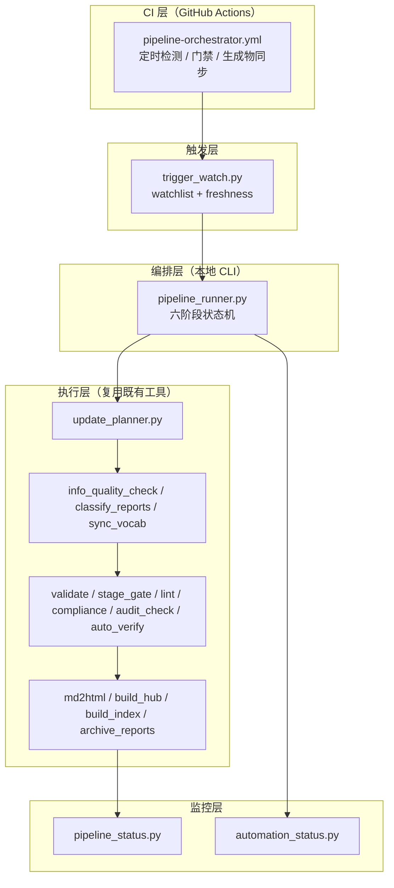
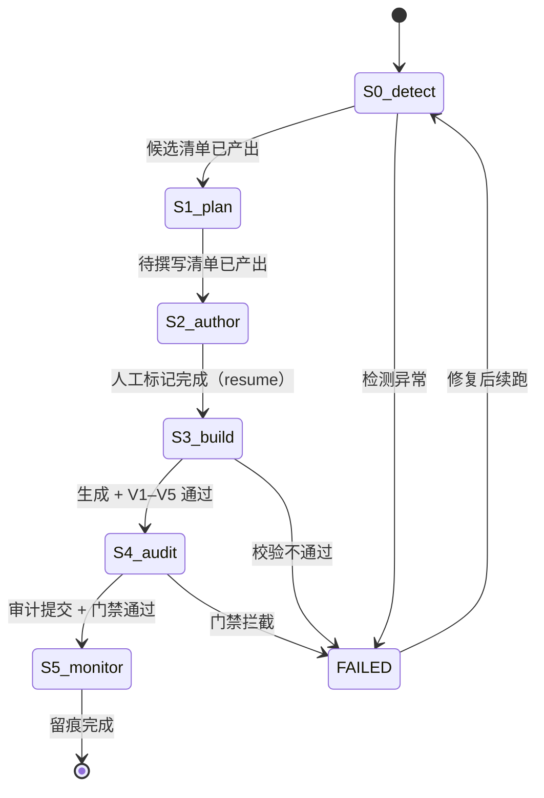

# 端到端流水线编排系统设计（PIPELINE-ORCHESTRATOR-DESIGN）

> **版本**：v0.1（草案）
> **日期**：2026-11-17
> **状态**：**待审定**（审定通过前不进入实施；审定记录见第九节）
> **工作树**：`task/pipeline-orchestrator-2026-11`
> **上位依据**：`AGENTS.md`（会话硬性规约）、[信息生产全链路执行规范](信息生产全链路执行规范.md)（PIPELINE-FLOW-SPEC）、[CI.md](CI.md)（CI-SYSTEM）、[审计报告标准化管理体系](审计报告标准化管理体系.md)（AuditGuard）、[架构优化技术方案-2026-11-16](架构优化技术方案-2026-11-16.md)（ARCH-OPT）、[月度批量更新唤醒词](月度批量更新唤醒词.md)
> **设计原则**：复用既有工具、不重建体系；人机接力、自动流转；单一事实源、守卫测试防漂移。

---

## 一、背景与目标

### 1.1 全维度盘点结论（审计对象 = 现有体系）

对「采集 → 清洗 → 校验 → 生成 → 输出 → 监控」全链路做了一次逐环节载体核对：

| 环节 | 现有载体 | 状态 |
|---|---|---|
| 采集触发检测 | `*/prompts/business-config.md` §7 触发器（自由文本）、`update_planner.py`（按节拍出清单） | ⚠️ 触发器未结构化，无命中检测 / 窗口到期提醒 |
| 数据清洗 | `info_quality_check.py --apply`、`sync_vocab.py`、`classify_reports.py --apply` | ✅ 单点齐全，缺统一编排与前后留痕 |
| 规则校验 | `validate.py` / `stage_gate_check.py` / `lint_reports.py` / `compliance_check.py` / `info_quality_check.py` / `audit_check.py`（L1–L5）/ `fact_card_check.py` / `pending_verification.py` / `personal_finance_model.py` / 词库三校验 | ✅ 成熟，双门禁阻断 |
| 内容生成 | `md2html.py` / `build_hub.py` / `build_index.py` / `archive_reports.py`；研究正文人 / Agent | ✅ 按纪律人工产出 |
| 状态监控 | `automation_status.py record` + `automation-status.json` | ⚠️ 只有单工作流心跳，无跨环节流水线视图 |
| **编排** | [月度批量更新唤醒词](月度批量更新唤醒词.md) 七步手册 + 若干单点工具 | ❌ **无生产级端到端编排器**（E2E 仅测试骨架 `src/tests/test_pipeline_e2e.py`） |

**结论**：体系约九成已就绪，真实缺口是**编排层**与**触发检测层**；本设计只补这两层 + 一个统一监控视图，不重建已有能力。

### 1.2 目标

在「研究正文由人 / Agent 产出」的边界内，把
`触发检测 → 计划 → 研究撰写 → 生成校验 → 审计提交 → 监控`
串成一条**有状态、可断点续跑、可观测、可治理**的端到端流水线，并使每个环节由工具固化、由 CI 与守卫测试防止漂移。

### 1.3 非目标（明确不做）

- **不自动撰写研究正文**（来源分级、无法核实须说明、不虚构的纪律不可破）。
- **不引入服务端 / 数据库 / 外部 API / 消息队列**（仓库是离线文档知识库，交付走 GitHub Actions + 静态 HTML）。
- **不改变**双阻断门禁、三层隔离（`workflow_guard`）、审计 L1–L5 与状态机。
- **不重建**已有 27 个工具；编排器是「串联者」，不是「替代者」。

---

## 二、多维度技术方案对比分析（核心模块一）

### 2.1 对比维度

| 维度 | 权重 | 说明 |
|---|---|---|
| 编排连续性 | 20% | 能否真正串起六环节、自动流转、断点续跑 |
| 触发检测能力 | 15% | 能否结构化 watchlist + freshness，产出可复核的候选 |
| 纪律兼容性 | 20% | 与「研究正文人工产出」「三层隔离」「双门禁」的兼容 |
| 可维护性 | 15% | 单一事实源、守卫测试、代码量与认知负担 |
| 实现成本 | 15% | 新增代码 / 配置 / 迁移成本 |
| 可观测性 | 15% | 状态可视、异常可定位、留痕可审计 |

### 2.2 候选方案

#### 方案 A · 本地 CLI 编排器 + Actions 包装（推荐）

- **形态**：新增 `src/prompts-tools/tools/pipeline_runner.py`（阶段状态机）+ `trigger_watch.py`（触发检测）+ `pipeline_status.py`（统一监控）；CI 侧新增/扩展一条工作流做**定时检测、门禁与生成物同步**。
- **人机接力**：编排器跑 S0 检测 → S1 计划，在 S2「研究撰写」处暂停并产出待办清单；人 / Agent 完成后 `resume --from-stage S3` 自动续跑 S3–S5。
- **优点**：复用全部既有工具；与 `workflow_guard` 三层隔离天然兼容；状态文件可审计；契合「无服务端、离线」架构；CI 只做自动化可承担的部分。
- **缺点**：本地运行依赖 Agent 会话（但研究正文本就需要人，属可接受）。
- **风险**：状态文件漂移、与并行会话争用（由 schema 校验 + 任务隔离缓解）。

#### 方案 B · 纯 GitHub Actions 编排

- **形态**：把六环节全部搬进 GitHub Actions 工作流。
- **优点**：常驻定时、表面「无人」。
- **缺点**：**研究正文写不了**（Actions 无法产出合规正文，违反纪律）；与本地多会话并行保护 / `main` 写入冲突；runner 侧抓取来源与「不虚构 / 来源分级」纪律冲突；状态难以回流本地。
- **结论**：**不采用**。

#### 方案 C · 手册形式化（不写编排器）

- **形态**：把七步手册升级为带检查点的强化版，靠 Agent 人工执行。
- **优点**：零新增代码、零漂移风险。
- **缺点**：无「自动流转」、无状态持久化、无统一监控，正是当前缺口的延续。
- **结论**：**不采用**（与「自动化流水线」目标冲突）；但手册保留为**人工应急预案**。

#### 方案 D · 引入外部调度器 / 服务器

- 直接排除：违反非目标（无服务端），且与仓库离线特性冲突。

### 2.3 多维度评分（1–5，加权求和）

| 维度 | 权重 | A | B | C |
|---|---|---|---|---|
| 编排连续性 | 20% | 5 | 3 | 2 |
| 触发检测能力 | 15% | 4 | 3 | 1 |
| 纪律兼容性 | 20% | 5 | 2 | 5 |
| 可维护性 | 15% | 4 | 3 | 5 |
| 实现成本 | 15% | 4 | 3 | 5 |
| 可观测性 | 15% | 4 | 3 | 2 |
| **加权总分** | | **4.45** | 2.75 | 3.55 |

### 2.4 择优决策

**采用方案 A**：本地 CLI 编排器 + Actions 包装。理由：唯一同时满足「自动流转」与「研究正文人工产出」边界的方案；复用既有工具链、与三层隔离和双门禁兼容、成本可控。方案 C 降级为人工应急预案（见第十一节）。

---

## 三、系统边界定义（核心模块二）

### 3.1 范围内

1. 触发检测：watchlist 结构化、freshness 检查、候选命中清单。
2. 编排：六阶段状态机、状态持久化、断点续跑、幂等。
3. 清洗 / 校验 / 生成：**编排既有工具**，不新写规则。
4. 监控：跨环节统一视图 + 心跳留痕。
5. CI：定时检测、计划生成、门禁与生成物同步。
6. 治理：阶段定义、命名、异常处理、漂移检测的规范固化。

### 3.2 范围外

| 项 | 说明 |
|---|---|
| 自动撰写研究正文 | 违反来源分级 / 不虚构纪律；永远人工 / Agent |
| 来源站点自动抓取与内容比对 | 抓取内容仍需人工核验，且与离线纪律有张力；本设计只做「候选提示」 |
| 服务端 / 数据库 / 外部 API | 非目标 |
| 修改既有 27 个工具的校验规则 | 复用；如确需修改走治理流程 |
| 取代 7 步手册 | 手册保留为人工应急预案 |

### 3.3 人机边界（唯一人工环节）

```
S0 检测   ┐
S1 计划   │ 机器
──────────┼────────────────────────────
S2 撰写   ← 唯一人工环节（人 / Agent 按 prompts 产出正文）
──────────┼────────────────────────────
S3 生成校验 ┐
S4 审计提交 │ 机器（自动续跑）
S5 监控   ┘
```

### 3.4 数据边界（新增文件，全部为派生 / 可重建）

| 文件 | 用途 | 是否入库 |
|---|---|---|
| `src/report-audits/pipeline/state-<period>.json` | 编排状态机 | 是（审计留痕） |
| `src/report-audits/pipeline/trigger-watch.json` | 触发检测快照 | 是 |
| `src/report-audits/pipeline/status.md` / `.json` | 统一监控视图 | 是 |
| `src/report-audits/pipeline/CHANGELOG.md` | 编排变更留痕 | 是 |

> 状态文件只存**路径 / 状态 / 时间戳 / 摘要**，不存正文、不存凭据。

### 3.5 时间边界

- 触发窗口沿用各主题 `business-config.md` 的节拍（月度核验 / 月度监测 / 事件触发 / 年度刷新 / 决策层季度）。
- CI 定时与本地编排的分工：**CI 只做检测 + 门禁**，不跑撰写（详见 6.7）。

### 3.6 接口边界（输入 / 输出）

| 接口 | 输入 | 输出 |
|---|---|---|
| 触发检测 | `business-config.md` §7、登记册核验日期 | `trigger-watch.json` + 候选清单 |
| 编排器 | 上述清单 + `--period` | 状态文件 + 各阶段产物（复用既有工具） |
| 监控 | 状态文件 + `automation-status.json` + 审计台账 | `status.md` / `.json` |
| CI | 仓库事件 / cron | 检测清单、门禁结论、生成物提交 |

---

## 四、总体架构

### 4.1 分层



### 4.2 状态机



### 4.3 数据流

`business-config §7 + 登记册` → `trigger-watch.json` → `state-<period>.json`（阶段推进）→ 既有工具产物（报告 md/html、审计台账）→ `status.md`。

---

## 五、关键模块设计

### 5.1 触发检测模块 `trigger_watch.py`

- **watchlist 来源**：不新增手工配置，**派生**自
  ① 各主题 `business-config.md` §7 触发器条目；
  ② 登记册「核验日期」；
  ③ `info_quality_check` 的 freshness 阈值（`STALE_DAYS` / `STALE_MONTHS`）。
- **检查项**：
  - `W1 窗口到期`：节拍窗口已到且期望输出缺失（复用 `update_planner` 的判定）。
  - `W2 核验超期`：登记册核验日期早于 freshness 阈值。
  - `W3 候选命中`：来源关键词的候选信号（**仅提示，不核实**）。
- **输出**：`trigger-watch.json`（机器读）+ 人读清单；命中 ≠ 核实，语义确认由 Agent 完成。
- **纪律**：默认只读；`--apply` 才写快照；无触发不虚构。

### 5.2 编排器 `pipeline_runner.py`

- **阶段**：`S0 detect → S1 plan → S2 author（人工闸门）→ S3 build → S4 audit → S5 monitor`。
- **状态持久化**：`state-<period>.json`，含 `schema_version`、各阶段 `status` / `started` / `completed` / `summary` / `artifacts`。
- **幂等**：每阶段可重复执行，产出一致；状态文件写回用 `atomic_write`（`_common`）。
- **断点续跑**：`run`（全流程，遇 S2 暂停）；`resume --from-stage S3`（人工完成后续跑）；`status`（只读视图）。
- **异常**：阶段失败写 `FAILED` 并记录原因；修复后从失败阶段续跑。
- **隔离**：编排器自身不写 `main`；提交仍走 `workflow_guard merge`。

### 5.3 清洗 / 5.4 校验 / 5.5 生成

不新写逻辑，编排器按顺序调用既有工具，并校验退出码：
- 清洗：`info_quality_check.py --apply`、`classify_reports.py --apply`、`sync_vocab.py sync`。
- 校验：`validate.py` → `lint_reports.py --new-only` → `auto_verify.py --report`（V1–V5）→ 失败走 `audit_preflight` / `audit_check` / `audit_pipeline --submit`。
- 生成：`md2html.py` → `build_index.py` → `archive_reports.py`（`build_hub.py` 由主会话统一执行，遵循 AGENTS.md）。

### 5.6 监控模块 `pipeline_status.py`

- 汇总：阶段进度、当前阻塞点、触发候选数、审计状态分布、CI 最近运行、活跃度。
- 输出：`status.md`（人读）+ `status.json`（机器读）。
- 心跳：复用 `automation_status.py record`，新增 `phase: pipeline`。

### 5.7 CI 接线

- 新增 `.github/workflows/pipeline-orchestrator.yml`（或扩展 `scheduled-report-tasks.yml`，二选一在实施计划定）：
  - `schedule`：月度窗口（与既有 4 条 cron 错开，避免互相抢占）。
  - `workflow_dispatch`：手动触发。
  - 步骤：跑 S0 + S1（只读检测 + 计划），提交 `trigger-watch.json` 与清单；命中候选开提醒 Issue。
  - **不跑 S2 及之后的本地撰写环节**；S3–S5 的生成 / 门禁由既有 `html-sync` / `validate` / `audit-gate` 承担。

---

## 六、交付物完整清单（核心模块三）

| # | 交付物 | 路径 | 说明 |
|---|---|---|---|
| D1 | 本系统设计文档 | `docs/端到端流水线编排系统设计-2026-11-17.md` | 四模块 + 审定 |
| D2 | 实施计划 | `docs/流水线编排实施计划-2026-11-17.md` | writing-plans 产出（仓库 `.gitignore` 忽略 `docs/superpowers/`，故置于 `docs/` 根） |
| D3 | 触发检测工具 | `src/prompts-tools/tools/trigger_watch.py` | watchlist + freshness |
| D4 | 编排器 | `src/prompts-tools/tools/pipeline_runner.py` | 六阶段状态机 |
| D5 | 监控视图 | `src/prompts-tools/tools/pipeline_status.py` | 统一状态视图 |
| D6 | CI 工作流 | `.github/workflows/pipeline-orchestrator.yml` | 定时检测 + 门禁接线 |
| D7 | 治理标准 | `docs/端到端流水线治理标准.md` | 阶段 / 命名 / 异常 / 漂移 |
| D8 | 测试用例 | `src/tests/test_pipeline_orchestrator.py` | 幂等 / 续跑 / 边界 |
| D9 | 一致性对齐验证报告 | `docs/流水线优化一致性对齐验证报告-*.md` | 方案 ↔ 计划 ↔ 实现对齐 |
| D10 | 工具索引更新 | `src/prompts-tools/tools/README.md` + `registry.json` | 登记新工具 |

---

## 七、潜在风险识别与应对策略（核心模块四）

| # | 风险 | 概率 | 影响 | 应对 |
|---|---|---|---|---|
| R1 | 状态文件漂移 / 损坏 | 中 | 中 | `schema_version` + 写入校验；损坏可重建；幂等 |
| R2 | 与并行会话争用 `main` | 中 | 高 | 全程走 `workflow_guard`；状态文件纳入任务范围；不直接 push |
| R3 | 触发检测误报 / 漏报 | 中 | 中 | 命中 ≠ 核实；只读；人工语义确认；阈值沿用既有 freshness |
| R4 | 被误读为「机器写正文」 | 中 | 高 | 治理标准明示人机边界；S2 为硬闸门；测试断言无自动正文 |
| R5 | 与七步手册重复 / 漂移 | 中 | 中 | 手册降级为人工预案；编排器为唯一自动入口；指针互指 |
| R6 | CI 定时与本地编排双跑重复 | 中 | 低 | 明确分工：CI 只检测 + 门禁；本地跑全流程 |
| R7 | 新增文件未纳入清理 / 门禁 | 低 | 中 | 同步 `cleanup_workspace.py` 与 `validate.yml` 断言 |
| R8 | 编排器调用工具顺序错误导致漏校验 | 低 | 高 | 阶段顺序固化 + 守卫测试；退出码严格校验 |

---

## 八、自动审定与择优决策

### 8.1 审定维度与结论

| 审定项 | 结论 |
|---|---|
| 是否复用既有工具、无冗余建设 | ✅ 仅新增编排 / 触发 / 监控三层 |
| 是否守住「研究正文人工产出」边界 | ✅ S2 硬闸门 |
| 是否与三层隔离 / 双门禁兼容 | ✅ 走 `workflow_guard` 与既有门禁 |
| 是否无服务端、契合离线架构 | ✅ 纯本地 CLI + Actions |
| 是否可观测、可审计 | ✅ 状态文件 + 监控视图 + 心跳 |
| 是否可维护、可演进 | ✅ 单一事实源 + 守卫测试 + 治理标准 |

### 8.2 择优结论

**方案 A（本地 CLI 编排器 + Actions 包装）** 以 4.45 分优于 B（2.75）/ C（3.55），且是唯一满足全部硬性边界的方案。**建议按此方向落地。**

### 8.3 审定清单（需你确认）

- [ ] 认可方案 A 为最终方向
- [ ] 认可系统边界（第三节，尤其「不自动撰写正文」）
- [ ] 认可交付物清单（第六节）
- [ ] 认可风险应对（第七节）
- [ ] 认可实施路径与验收指标（第九节）

---

## 九、实施路径与验收指标（概要）

| 阶段 | 内容 | 验收指标 |
|---|---|---|
| P0 审定 | 本设计文档审定 | 五项 checklist 全通过 |
| P1 基础设施 | `_common` 扩展、状态 schema、测试骨架 | 单测通过；schema 校验用例 ≥ 3 |
| P2 触发检测 | `trigger_watch.py` + 派生逻辑 | 幂等（重复跑零差异）；只读默认；单测 ≥ 6 |
| P3 编排器 | `pipeline_runner.py` 状态机 | 断点续跑用例 ≥ 4；失败可恢复；单测 ≥ 8 |
| P4 监控与 CI | `pipeline_status.py` + 工作流 | CI 全绿；监控视图字段齐全 |
| P5 治理与验收 | 治理标准 + 全链路验证 | 一致性对齐验证报告通过；既有 285+ 测试无回归 |

> 详细任务节点、责任人、时间节点与验收标准由 writing-plans 产出（D2）。

---

## 十、治理标准纲要（详见 D7）

1. **阶段定义**：S0–S5 的输入 / 输出 / 退出条件 / 责任人。
2. **命名**：状态文件 `state-<period>.json`；快照 `trigger-watch.json`；工具 `*_watch.py` / `pipeline_*.py`。
3. **状态机**：合法转换与非法转换清单。
4. **异常处理**：FAILED 记录 / 续跑 / 人工介入条件。
5. **漂移检测**：守卫测试断言编排器引用既有工具、阶段顺序不变。
6. **变更流程**：阶段 / 阈值 / 边界变更须走维护规范并留痕。
7. **版本迭代**：`schema_version` 与向后兼容策略。

---

## 十一、附录：与现有体系的映射（防冗余 / 防漂移）

| 现有载体 | 本设计关系 |
|---|---|
| [信息生产全链路执行规范](信息生产全链路执行规范.md) | 上位流程规范；本设计是其「编排层」实现，不修改其五阶段 / 五闸 |
| [月度批量更新唤醒词](月度批量更新唤醒词.md) 七步手册 | 降级为**人工应急预案**；编排器为唯一自动入口；手册加互指指针 |
| `update_planner.py` | 被编排器 S1 复用（不修改） |
| `automation_status.py` | 被监控层复用，新增 `phase: pipeline` |
| `audit_pipeline` / `audit_check` / `audit_preflight` / `auto_verify` | 被 S3 / S4 复用（不修改规则） |
| `workflow_guard` | 提交与合并通道，不修改 |
| 7 条既有工作流 | 生成 / 门禁仍由其承担；新增 1 条检测工作流 |

---

## 版本记录

| 版本 | 日期 | 变更 | 说明 |
|---|---|---|---|
| v0.1 | 2026-11-17 | 初始草案 | 四模块 + 自动审定；待用户审定 |
